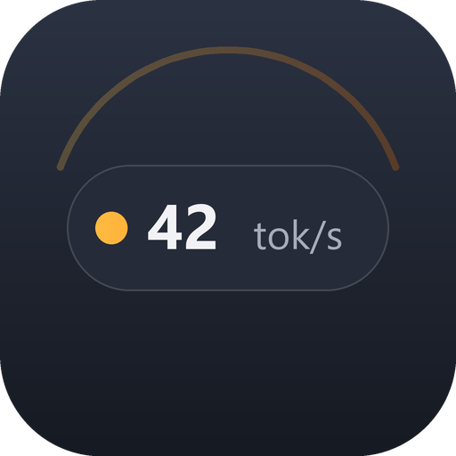
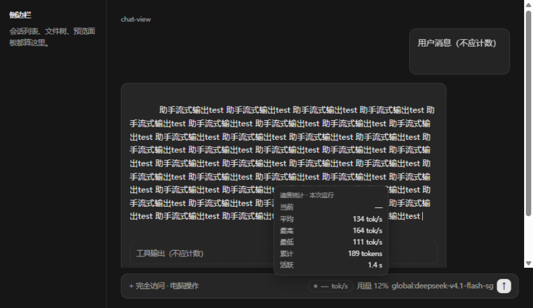

<div align="center">



# ZCode Tok/s Badge

**给 ZCode 桌面版聊天界面加一个胶囊形 `tok/s` 徽标**（非官方，与 ZCode 官方无隶属、合作或授权关系）

流式输出时看速度，空闲时安静地待在输入框工具条里。


</div>

---

## 这是什么

在 ZCode 桌面版（Electron）的输入框底部工具条里注入一个胶囊徽标：
流式输出时显示估算的 token 吞吐量，鼠标悬停显示本次运行的统计。

不修改 ZCode 源码、不碰网络请求、不读取对话内容，只统计聊天区里正在增长的文本。

## 效果



- 流式输出：`42.1 tok/s`（超过 100 时取整）
- 空闲约 1.8 秒：`— tok/s`
- 位置：输入框工具条、用量 / 模型选择器左侧；窗口缩放时随工具条重排并三档收缩
- 悬停：弹出当前 / 平均 / 最高 / 最低 / 累计 tokens / 活跃时长
- 深 / 浅主题自动适配

## 环境要求

- Windows + ZCode 桌面版（Electron）
- Node.js 20+（打补丁 / 还原 / 预览；徽标本身无依赖）
- 备用模式的 CDP 注入器需要 Node.js 22+（用到全局 `WebSocket`）

## 安装

1. 从**托盘图标**完全退出 ZCode（点窗口 X 只是收进托盘，进程还在）。
2. 双击 `tools/apply.cmd`，看到 `Applied` 和 `verified: unpacked=true ...`。
3. 用平时的方式启动 ZCode。
4. 输入框底部工具条出现胶囊徽标。

命令行等价：

```bash
node src/patch.mjs --apply
```

ZCode 正在运行又不想退出时，可以加 `--force`；补丁会立即写入，但徽标要等下次完全重启才出现。

ZCode 路径解析顺序：`ZCODE_RESOURCES` / `ZCODE_EXE` 环境变量 → 项目根 `config.local.json` → `%LOCALAPPDATA%\Programs\ZCode\resources`。详见 [docs/BUILD.md](docs/BUILD.md)。

## 使用

- 徽标在输入框工具条里、用量左侧，随窗口缩放重排并自动收缩；不拦截鼠标。
- 只在工具条出现后注入，不会先出现在右下角。
- 有流式文本时显示数值，停止输出约 1.8 秒后变回 `— tok/s`。
- 思考文本和工具调用阶段也会计入；输入框、侧边栏、用户消息、终端、开发者工具不计入。

### 悬停统计

鼠标放到徽标上 120ms 后弹出统计卡，移开 80ms 后淡出。

| 行 | 含义 |
|---|---|
| 当前 | 最近一次 EMA 速度 |
| 平均 | 累计 tokens / 活跃时长 |
| 最高 | 单次结算的最高瞬时速度 |
| 最低 | 单次结算的最低瞬时速度 |
| 累计 | 本次运行计入的 tokens |
| 活跃 | 有输出的结算时长 |

## 反馈

遇到问题、想要新功能，或者 ZCode 升级后徽标失灵，都可以到
[Issues](https://github.com/MVennn/ZCodeTpsBadge/issues) 反馈。

请附上：ZCode 版本、`node src/patch.mjs` 的输出、复现步骤；样式问题附截图。

## 排错

见 [docs/TROUBLESHOOTING.md](docs/TROUBLESHOOTING.md)。最常见的四类：

- 只关了窗口没退托盘 → preload 没有重新加载；
- ZCode 升级覆盖了 `app.asar` → 重新 apply；
- 工具条还没渲染（设置页等）→ 徽标不注入，属预期；
- 一直是 `— tok/s` → 确认是聊天区里的助手输出；工具调用和侧边栏不计入。

## 卸载

1. 从托盘完全退出 ZCode。
2. 双击 `tools/restore.cmd`（或 `node src/restore.mjs`）。
3. 启动 ZCode，徽标消失。

## 备用模式（CDP，不改 app.asar）

如果不想修改 ZCode 安装文件，或者补丁失效，可以用 `tools/launch-zcode-tps.vbs`：

- 以 `--remote-debugging-port=9222` 启动 ZCode（只监听 127.0.0.1）；
- 后台 `tools/injector.mjs` 通过 CDP 注入同一个徽标；
- 需要先完全退出 ZCode，启动器会检查；
- 运行期间本机任意进程都能连 9222 控制 ZCode（包括读对话），只建议在自己机器上用。

## 文件结构

```
ZCodeTpsBadge/
├── assets/                 # 图标、社交预览、效果截图
├── docs/                   # 文档正本（索引见 docs/README.md）
├── src/
│   ├── badge-source.mjs    # 徽标代码（preload 与 CDP 共用）
│   ├── config.mjs          # ZCode 路径解析
│   ├── which.mjs           # 打印解析结果
│   ├── patch.mjs           # asar 补丁
│   └── restore.mjs         # 还原
├── tools/
│   ├── apply.cmd           # 双击打补丁
│   ├── restore.cmd         # 双击还原
│   ├── injector.mjs        # CDP 注入器（备用模式）
│   ├── launch-zcode-tps.*  # 备用模式启动器
│   ├── gen_assets.py       # 重新生成图标与社交预览
│   ├── ci/check.mjs        # 仓库检查
│   └── preview/            # 本地预览
├── .github/                # Issue 模板与 CI
├── package.json            # 版本与 npm scripts
├── README.md
├── CHANGELOG.md
├── CONTRIBUTING.md
├── SECURITY.md
└── LICENSE
```

## 开发

```bash
npm run check       # 语法 + 文档链接 + 资源 + 本机路径检查
npm run preview     # 生成并启动本地预览
npm run patch       # 打补丁
npm run restore     # 还原
python tools/gen_assets.py   # 重新生成图标（需要 Pillow）
```

改动前先读 [docs/REPO-STANDARD.md](docs/REPO-STANDARD.md)（仓库规范）、
[docs/CODE-RULES.md](docs/CODE-RULES.md)（编码纪律）与
[docs/DOC-RULES.md](docs/DOC-RULES.md)（文档规则）。

## 免责声明

- 非官方项目，与 ZCode 官方及其关联方无任何隶属、合作、授权或支持关系。
- 会修改本地 ZCode 安装目录的 `app.asar`；ZCode 升级会覆盖补丁，需要重新应用。
- 徽标数值是按页面文本估算的，不是模型返回的精确 usage，不用于计费或性能结论。
- 不收集、不上传任何数据，不读取对话内容。

## 开源鸣谢

| 项目 | 用途 |
|---|---|
| ZCode 桌面版 | 宿主应用 |
| [Node.js](https://nodejs.org/) | 补丁、预览与工具脚本 |
| [Pillow](https://python-pillow.org/) | 图标与社交预览生成 |
| [GitHub](https://github.com/) | 代码托管与 CI |

## 许可证

[MIT](LICENSE)。

## 文档

文档索引：[docs/README.md](docs/README.md)。
